<div align="center">

<p align="center">
  <a href="https://github.com/ishandutta2007/Awesome-Awesome-Awesome"></a><a href="https://discord.gg/jc4xtF58Ve"></a>
  <a href="https://github.com/ishandutta2007/Awesome-Data-Detection-And-Response-DDR/stargazers"></a>
  <a href="https://github.com/ishandutta2007/Awesome-Data-Detection-And-Response-DDR/network/members"></a>
  <a href="https://github.com/ishandutta2007/Awesome-Data-Detection-And-Response-DDR/issues"></a>
  <a href="https://github.com/ishandutta2007/Awesome-Data-Detection-And-Response-DDR/blob/main/LICENSE"></a>
  <a href="https://github.com/ishandutta2007"></a>
</p>

[](https://github.com/ishandutta2007/Awesome-Data-Detection-And-Response-DDR)

# 🛡️ Awesome Data Detection and Response (DDR) 🔍

### *A Curated Guide to Enterprise DDR, Data Security Posture Management (DSPM), Behavioral Threat Analytics & Automated Exfiltration Response*

[](https://github.com/ishandutta2007/Awesome-Data-Detection-And-Response-DDR/blob/main/README.md#how-to-contribute)
[](https://github.com/ishandutta2007/Awesome-Data-Detection-And-Response-DDR/commits/main)
[](https://github.com/ishandutta2007/Awesome-Data-Detection-And-Response-DDR/commits/main)

</div>

---

## 📖 Executive Summary & Scope

**Data Detection and Response (DDR)** represents the modern, data-centric evolution of threat detection and Data Loss Prevention (DLP). While traditional Endpoint Detection and Response (EDR) and SIEM tools monitor infrastructure, devices, and network perimeters, DDR platforms focus directly on the **data asset layer**. DDR continuously monitors how sensitive data (PII, PHI, financial records, intellectual property, and proprietary AI datasets) is accessed, modified, copied, and moved across multi-cloud environments (AWS, Azure, GCP), hybrid lakehouses (Snowflake, Databricks), endpoints, and SaaS applications.

By establishing behavioral baselines and analyzing file activity telemetry, DDR systems identify anomalous access patterns—such as insider threats, credential theft, bulk exfiltration attempts, and ransomware encryption staging—and trigger immediate, automated containment workflows (e.g., Safe Mode isolation, session termination, and access revocation).

```
   ┌────────────────────────────────────────────────────────┐
   │          Data Detection & Response (DDR) Cycle          │
   └────────────────────────────────────────────────────────┘
         │
         ▼
  [1. Discover & Map] ────► Real-time DSPM sensitive data cataloging
         │
         ▼
  [2. Observe & Profile] ─► User & entity behavioral telemetry (UEBA)
         │
         ▼
  [3. Detect Anomalies] ──► Exfiltration, privilege abuse, shadow data
         │
         ▼
  [4. Automated Response] ─► Safe Mode quarantine, credential revocation
```

---

## 📑 Table of Contents

- [📊 Sector Overview & Market Dynamics](#-sector-overview--market-dynamics)
- [☁️ SaaS / Hosted DDR Platforms](#️-saas--hosted-ddr-platforms)
- [💻 Open-Source GitHub Projects](#-open-source-github-projects)
- [🏗️ Architectural Guide: Building Open-Source DDR](#️-architectural-guide-building-open-source-ddr)
- [🤝 How to Contribute](#-how-to-contribute)
- [💖 Support & Community](#-support--community)
- [📈 Star History](#-star-history)
- [⚠️ Disclaimer](#️-disclaimer)

---

## 📊 Sector Overview & Market Dynamics

The global **Data Detection and Response (DDR)** market is valued at **$4.0B – $4.5B** in 2026 and is forecasted to reach **$9.3B by 2031**, progressing at a compound annual growth rate (**CAGR of ~15.6%**). 

### Key Industry Dynamics:
- **Market Structure**: The sector is currently **moderately fragmented**. High-growth specialized startups (e.g., Cyera, Sentra, Securiti) lead innovation in AI-native classification and cloud-native lakehouse telemetry, while enterprise legacy giants (IBM, Proofpoint, Cisco, and CrowdStrike) actively consolidate the space through major strategic acquisitions.
- **Primary Growth Drivers**:
  1. **Enterprise Cloud & SaaS Sprawl**: The explosive proliferation of unstructured data across multi-cloud buckets, Snowflake, Databricks, and SaaS apps rendering perimeter-only security obsolete.
  2. **LLM & GenAI Data Exposure**: High-risk data ingestion into internal and public generative AI models and autonomous agent workflows.
  3. **Regulatory Pressure**: Stricter worldwide data privacy and sovereign security mandates (GDPR, CCPA/CPRA, HIPAA, SEC cyber disclosure rules) enforcing rapid breach notification and auditable access histories.

---

## ☁️ SaaS / Hosted DDR Platforms

*Enterprise-grade commercial platforms offering data-centric behavioral analytics, DSPM discovery, and automated response capabilities. Sorted by **Company Size / Valuation (Descending)**.*

| Product | Company Size / Valuation | Description | Pricing (Starting Tier) | Free Tier / Trial Limits |
|---|---|---|---|---|
| **[Polar Security (IBM)](https://www.ibm.com/products/guardium-insights)** | **$231B+ Market Cap** (Parent IBM; Polar acquired for ~$60M) | DSPM and DDR platform integrated into IBM Guardium Insights. Automatically discovers, classifies, and maps sensitive data flows across AWS, Azure, and GCP with automated policy-driven response. | Starting from **$15,000/year** (IBM Guardium SaaS baseline) | **30-day free trial** with full access to cloud data discovery connectors and policy evaluation. |
| **[Normalyze](https://www.normalyze.com/)** | **$12.3B Valuation** (Parent Proofpoint / Thoma Bravo; acquired ~$76M) | Cloud data security and DDR platform mapping sensitive data exposure, privileges, and attack paths across cloud, DBaaS, and SaaS environments. | Starting from **$1,500/month** ($18,000/year for Premium tier) | **Free Forever Tier**: 1 cloud account (AWS, Azure, or GCP), basic data risk dashboards, up to 30 days of graph history tracking (scanning capped at baseline snapshot). |
| **[Cyera](https://www.cyera.io/)** | **$12B Valuation** (Series G unicorn; ~$200M ARR) | AI-native data security platform unifying DSPM, DDR, and data access governance. Uses LLM-driven classification to detect real-time file exfiltration and anomalous access across multi-cloud and SaaS. | Starting at **$50,000/year** (AWS Marketplace Standard tier, covers up to 25 TB data capacity) | **No free tier**; interactive sandbox and custom **14-day guided Proof of Concept (PoC)** upon sales qualification. |
| **[Varonis Data Security Platform](https://www.varonis.com/)** | **$5.6B Market Cap** (NASDAQ: VRNS; ~$716M TTM Revenue) | Pioneer data security and behavior analytics platform covering cloud, SaaS, and on-premises environments. Features Managed DDR (MDDR) for proactive threat hunting and automated response. | Starting from **$50 – $95/user/year** (DSPM/SaaS baseline; managed DDR add-on +$25–$50/user/year; typical entry contract ~$15,000–$25,000/year) | **30-day Data Risk Assessment (free trial)**: Scans a designated enterprise environment (M365, AWS, or on-prem) to produce a comprehensive vulnerability and exposure report. |
| **[Druva Managed DDR (MDDR)](https://www.druva.com/)** | **$2.0B Valuation** (Private unicorn; ~$200M+ ARR) | 24/7 managed detection and response on backup repositories and SaaS data. Features **Safe Mode** to pause malicious restores, block deletions, and lock down compromised admin accounts. | Starting from **$2.50/user/month** (inSync SaaS) or **$450/TB/year** (Server Workloads on AWS Marketplace); MDDR included at no extra cost with Druva enterprise subscriptions | **30-day free trial**: Full access to configure server or SaaS workloads, backup automation, and live support (no credit card required). |
| **[Securiti](https://securiti.ai/)** | **$1.725B Valuation** (Acquired by Veeam; ~$100M+ ARR) | Unified Data Command Center delivering DDR, DSPM, privacy compliance, and LLM firewalls. Detects policy violations, unauthorized cross-border transfers, and shadow data movement. | Starting from **$50,000/year** (AWS Marketplace / modular contract baseline; ~$3,500–$5,000/month for initial suites) | **No self-serve free tier**; free access to PrivacyOps/AI Governance Academy certification courses, and custom **14-day assisted PoC** upon enterprise review. |
| **[BigID DDR](https://bigid.com/)** | **$1.0B+ Valuation** (Riverwood Capital; ~$100M ARR) | Enterprise data intelligence and DDR platform with 100+ connectors. Uses deep ML classification to track sensitive data access and trigger remediation via Microsoft Purview and SOAR tools. | Starting at **$175,000/year** (AWS Marketplace Discovery Foundation 12-month commitment) | **No free tier**; tailored **30-day enterprise Proof of Concept (PoC)** available via enterprise sales qualification. |
| **[Forcepoint DDR](https://www.forcepoint.com/)** | **~$800M Valuation** (Francisco Partners; ~$350M–$400M Revenue) | Cloud and endpoint DDR leveraging AI Mesh classification to track continuous data interactions (file reads, shares, renames, copies) and halt exfiltration across hybrid endpoints. | Starting from **$45 – $70/user/year** (Forcepoint ONE Cloud Security / DLP baseline suite) | **30-day free trial** for cloud security modules, or 14-day assisted trial through enterprise sales channel. |
| **[Sentra](https://sentra.io/)** | **~$350M – $450M Valuation** (Series C funded; tens of millions ARR) | Cloud-native DSPM and DDR platform designed to track sensitive data movement across AWS, Azure, GCP, and Snowflake, detecting rogue exfiltration channels and misconfigurations. | Starting at **$50,000/year** (AWS Marketplace Standard plan baseline) | **No free tier**; structured **14-day to 30-day guided Proof of Concept (PoC)** upon enterprise onboarding. |
| **[Theom](https://theom.ai/)** | **~$80M Valuation** (Series A; backed by Databricks, Snowflake & SentinelOne) | Data-centric DDR and posture management built specifically for cloud data warehouses and lakehouses (Snowflake, Databricks, BigQuery, AWS S3), monitoring insider risks and exfiltration queries. | Starting from **$25,000/year** (Cloud Lakehouse baseline tier) | **14-day free trial** via AWS Marketplace and direct cloud-connect demo with sample data lake audit. |

---

## 💻 Open-Source GitHub Projects

*Active community repositories providing data discovery, sensitive field classification, system telemetry, and detection-as-code building blocks. Sorted by **GitHub Star Count (Descending)**.*

| Project | Star Badge | Focus Area | Description |
|---|---|---|---|
| **[Gitleaks](https://github.com/gitleaks/gitleaks)** | [](https://github.com/gitleaks/gitleaks/stargazers) | `Secret Detection` `DLP` | High-speed static analysis tool designed to detect hardcoded secrets, API tokens, passwords, and sensitive keys in git repositories, commits, files, and CI/CD pipelines. |
| **[TruffleHog](https://github.com/trufflesecurity/trufflehog)** | [](https://github.com/trufflesecurity/trufflehog/stargazers) | `Data Leak Scanner` `Exfiltration` | Searches git repositories, file systems, and S3 buckets for exposed high-entropy secrets and sensitive credentials, with built-in live verification engines. |
| **[Osquery](https://github.com/osquery/osquery)** | [](https://github.com/osquery/osquery/stargazers) | `Endpoint Telemetry` `FIM` | SQL-powered operating system instrumentation framework. Enables security engineers to query endpoint file read events, socket connections, and process executions in real time. |
| **[Wazuh](https://github.com/wazuh/wazuh)** | [](https://github.com/wazuh/wazuh/stargazers) | `SIEM` `XDR` `Active Response` | Open-source security platform providing file integrity monitoring (FIM), system audit logging, behavioral detection rules, and automated remediation actions. |
| **[OpenMetadata](https://github.com/open-metadata/OpenMetadata)** | [](https://github.com/open-metadata/OpenMetadata/stargazers) | `Data Catalog` `Lineage` `DSPM` | Metadata management platform featuring column-level data lineage, automated classification, and governance tagging—serving as the foundational inventory for DDR. |
| **[DataHub](https://github.com/datahub-project/datahub)** | [](https://github.com/datahub-project/datahub/stargazers) | `Data Governance` `Discovery` | Extensible metadata catalog created at LinkedIn. Delivers full data discovery, entity relationship mapping, and dataset sensitivity profiling across data lakes. |
| **[Microsoft Presidio](https://github.com/microsoft/presidio)** | [](https://github.com/microsoft/presidio/stargazers) | `PII Identification` `Redaction` | Context-aware PII detection and anonymization SDK from Microsoft. Uses Named Entity Recognition (NER), regular expressions, and checksum validators to flag sensitive entities. |
| **[Panther Analysis](https://github.com/panther-labs/panther-analysis)** | [](https://github.com/panther-labs/panther-analysis/stargazers) | `Detection-as-Code` `Cloud Audit` | Open-source detection-as-code rules, audit policies, and real-time response handlers for AWS CloudTrail, Snowflake, Okta, and Box to catch exfiltration attempts. |
| **[OpenCSPM](https://github.com/OpenCSPM/opencspm)** | [](https://github.com/OpenCSPM/opencspm/stargazers) | `Cloud Posture` `Access Mapping` | Open-source Cloud Security Posture Management engine providing a graph-based inventory of cloud assets, access permissions, and exposed data stores. |
| **[Privacy Firewall](https://github.com/privacyshield-ai/privacy-firewall)** | [](https://github.com/privacyshield-ai/privacy-firewall/stargazers) | `Local LLM DLP` `Browser Security` | Client-side data loss prevention tool using in-browser local AI to intercept and block sensitive enterprise credentials or data from being sent to external LLMs. |
| **[hitsz-ids/openDLP](https://github.com/hitsz-ids/openDLP)** | [](https://github.com/hitsz-ids/openDLP/stargazers) | `Data Classification` `DLP` | Sensitive data scanning toolkit using regex, NLP rules, and validation algorithms to perform automated field-level sensitivity classification across databases and JSON files. |

---

## 🏗️ Architectural Guide: Building Open-Source DDR

Because no single turnkey open-source product mirrors full commercial DDR suites today, engineering teams build modular DDR pipelines using four architectural layers:

```
  ┌────────────────────────────────────────────────────────┐
  │ Layer 1: Data Discovery & Classification (DSPM Core)   │
  │ Tools: Microsoft Presidio, hitsz-ids/openDLP           │
  └───────────────────────────┬────────────────────────────┘
                              │
                              ▼
  ┌────────────────────────────────────────────────────────┐
  │ Layer 2: Metadata Cataloging & Access Mapping          │
  │ Tools: OpenMetadata, DataHub, OpenCSPM                 │
  └───────────────────────────┬────────────────────────────┘
                              │
                              ▼
  ┌────────────────────────────────────────────────────────┐
  │ Layer 3: Runtime Telemetry & Activity Auditing         │
  │ Tools: Osquery (endpoints), AWS CloudTrail / GCP Audit │
  └───────────────────────────┬────────────────────────────┘
                              │
                              ▼
  ┌────────────────────────────────────────────────────────┐
  │ Layer 4: Behavioral Detection & Automated Containment  │
  │ Tools: Wazuh, Panther Analysis, n8n / Tines / SOAR     │
  └────────────────────────────────────────────────────────┘
```

1. **Discovery & Classification**: Scan databases, S3 buckets, and file shares with **Microsoft Presidio** or **openDLP** to tag columns and files with sensitivity classes (e.g., `CONFIDENTIAL`, `PII_SSN`).
2. **Metadata Inventory**: Ingest discovered assets and classification tags into **OpenMetadata** or **DataHub** to establish lineage and dataset ownership.
3. **Telemetry Ingestion**: Stream object-level audit logs (e.g., AWS CloudTrail `GetObject` events, Snowflake access history, or **Osquery** file event logs).
4. **Detection & Response**: Write behavioral detection rules in **Panther Analysis** or **Wazuh** to flag mass downloads, off-hours access, or impossible travel anomalies, triggering automated IAM credential revocation or network isolation.

---

## 🤝 How to Contribute

Contributions are warmly encouraged! To propose updates or add new tools:

1. 🍴 **Fork the Repository**: Click "Fork" at the top right of this page.
2. 🌿 **Create a Feature Branch**: `git checkout -b add-tool-name`
3. 📝 **Add Your Entry**: Ensure descriptions are factual, links point directly to official sites, pricing is verified, and open-source entries include valid star badges.
4. 🚀 **Submit a Pull Request**: Provide a clear summary of your additions.

---

## 💖 Support & Community

If you find this DDR curated ecosystem useful for your security engineering research, architecture reviews, or open-source stack building, please consider supporting the project:

- ⭐ **Star this repository** to help other security practitioners discover it!
- 🍴 **Fork and share** with your SecOps, DevSecOps, and GRC peers.
- 💬 **Join our community discussion** on [Discord](https://discord.gg/jc4xtF58Ve).
- ☕ **Support ongoing maintenance**: You can sponsor or buy a coffee via the [GitHub Sponsor Dashboard](https://github.com/sponsors/ishandutta2007).

---

## 📈 Star History

[](https://www.star-history.com/#ishandutta2007/Awesome-Data-Detection-And-Response-DDR&type=date&legend=top-left)

---

## ⚠️ Disclaimer

- This list is **community-curated** for educational, architectural, and security evaluation purposes; it does not constitute an explicit commercial endorsement.
- DDR platforms monitor sensitive data access patterns and user activity. Deployers must verify compliance with local labor and data privacy legislation (GDPR, CCPA, HIPAA, and employee notice requirements).
- Pricing structures, valuations, and trial terms change over time. Verify current commercial offerings directly with the respective vendor sales representatives.

---

<div align="center">
  <b>Maintained with ❤️ for security engineers, SOC analysts, DPOs, and security architects worldwide.</b>
</div>
